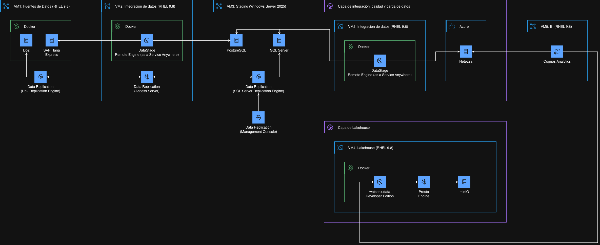

# INAVIT: del dato operativo a la decisión, de punta a punta



INAVIT es un fondo de vivienda ficticio con datos sintéticos de México. Sus aportaciones
patronales viven en Db2 y su cartera de créditos en SAP HANA, en sistemas aislados, con errores de captura, y sin
forma de ver a tiempo cuando un patrón deja de aportar. La demo sigue al dato de punta a punta: IBM Data
Replication captura los cambios de Db2 en segundos y DataStage extrae la cartera de SAP HANA. DataStage integra y
depura las dos fuentes en Netezza. Cognos Analytics responde las preguntas de negocio y watsonx.data guarda la
historia en un lakehouse abierto, que se consulta junto con los datos recientes de Netezza.

Todos los datos son **sintéticos**: ningún NSS, CURP, RFC, nombre o registro patronal es real.

## Fases

| Fase | Dónde | Qué ocurre |
|---|---|---|
| 1 · Fuentes de datos | VM1 | SAP HANA (cartera: 105 mil créditos, 2.2 M de pagos) y Db2 (15 mil patrones, 251 mil trabajadores, 2.6 M de aportaciones) en Docker, con errores de captura sembrados |
| 2 · Replicación en tiempo real | VM1 → VM2 → VM3 | Data Replication lee el log de Db2 y, coordinado por el Access Server, aplica cada cambio en SQL Server en segundos |
| 3 · Extracción de la cartera | VM1 → VM2 → VM3 | El motor remoto de DataStage copia SAP HANA en lote a PostgreSQL, sin transformar |
| 4 · Integración, calidad y carga | VM3 → VM2 → Netezza | DataStage normaliza y cruza las dos fuentes, marca cada corrección y separa rechazos; cuadre exacto 104,871 + 444 = 105,315 |
| 5 · Almacén analítico | Netezza (Azure) | 11 tablas y 6 vistas con morosidad, patrones omisos y precalificados; consultas en segundos |
| 6 · Inteligencia de negocio | VM5 | Cognos: 8.2% de morosidad (38.7% con patrón omiso), 1,083 omisos, 25,583 precalificados |
| 7 · Lakehouse y consulta federada | VM4 | Historia en Iceberg sobre MinIO; Presto la une con lo reciente de Netezza en una sola vista |

Descripción completa de cada fase: [`docs/arquitectura.md`](docs/arquitectura.md).

## Qué demuestra

| Mensaje | Dónde se ve |
|---|---|
| Captura de cambios en segundos sin tocar la aplicación | Data Replication replica Db2 → SQL Server (acto 3 del guion) |
| Calidad de datos medible y con evidencia | DataStage marca cada corrección (`DQ_*`) y separa rechazos con motivo |
| Una sola versión del dato | Cuadre exacto HANA ↔ Netezza ↔ Cognos (105,315 = 104,871 + 444) |
| Aviso temprano de riesgo | Mora con patrón omiso 38.7% contra 6.7% al corriente |
| Historia barata en formato abierto | watsonx.data: Iceberg sobre MinIO, vista federada con Netezza |

## Componentes

| Host | Sistema operativo | Componentes | Guía |
|---|---|---|---|
| VM1 · Fuentes de datos | RHEL 9.8 | Db2 y SAP HANA Express (Docker); Data Replication: motor de Db2 | [`vm1-fuentes/`](vm1-fuentes/), [`docs/01-vm1-fuentes.md`](docs/01-vm1-fuentes.md) |
| VM2 · Integración de datos | RHEL 9.8 | DataStage Remote Engine as a Service Anywhere (Docker); Data Replication: Access Server | [`docs/04-datastage.md`](docs/04-datastage.md), [`docs/02-replicacion-iidr.md`](docs/02-replicacion-iidr.md) |
| VM3 · Staging | Windows Server 2025 | PostgreSQL (`inavit_stg.hana_raw`); SQL Server 2019 (`INAVIT_STG`); Data Replication: motor de SQL Server y Management Console | [`docs/03-staging-vm3.md`](docs/03-staging-vm3.md) |
| Netezza SaaS | Azure (East US 2) | Netezza Performance Server (`INAVIT_DW`) | [`netezza/`](netezza/), [`docs/05-netezza.md`](docs/05-netezza.md) |
| VM4 · Lakehouse | RHEL 9.8 | watsonx.data Developer Edition, Presto y MinIO (Docker / KIND) | [`watsonx-data/`](watsonx-data/), [`docs/07-watsonx-data.md`](docs/07-watsonx-data.md) |
| VM5 · BI | RHEL 9.8 | Cognos Analytics 12.1.3 | [`cognos/`](cognos/), [`docs/06-cognos.md`](docs/06-cognos.md) |

## Prerrequisito

Las VMs con sus componentes instalados, como quedaron en el proyecto original:

- **VM1:** RHEL 9.8 con Docker, 8 vCPU, ~32 GB de RAM y ≥ 100 GB libres en `/opt`; motor de Data Replication para Db2.
- **VM2:** RHEL 9.8 con el motor remoto de DataStage (Docker) y el Access Server de Data Replication; conectividad a VM1 (HANA 39041), VM3 (1433, 5432) y Netezza (5480).
- **VM3:** Windows Server 2025 con SQL Server 2019, PostgreSQL, el motor de Data Replication para SQL Server y Management Console.
- **VM4:** RHEL 9.8 con watsonx.data Developer Edition instalado con [`jckulco/wxd-remote-access`](https://github.com/jckulco/wxd-remote-access).
- **VM5:** RHEL 9.8 con Cognos Analytics 12.1.3 y su Content Store.
- **Netezza SaaS (Azure):** una instancia con usuario que pueda crear esquemas y tablas.

## Orden para reconstruir el proyecto

| Paso | Qué | Guía | Tiempo aprox. |
|---|---|---|---|
| 1 | Configura accesos y túneles | [`docs/00-accesos-y-tuneles.md`](docs/00-accesos-y-tuneles.md) | 15 min |
| 2 | Levanta y puebla las fuentes en VM1 | [`docs/01-vm1-fuentes.md`](docs/01-vm1-fuentes.md) | 30-45 min |
| 3 | Prepara staging en VM3 | [`docs/03-staging-vm3.md`](docs/03-staging-vm3.md) | 20 min |
| 4 | Configura la replicación IIDR Db2 → SQL Server | [`docs/02-replicacion-iidr.md`](docs/02-replicacion-iidr.md) | 30-60 min |
| 5 | Crea el esquema en Netezza | [`docs/05-netezza.md`](docs/05-netezza.md) | 10 min |
| 6 | Importa y corre los flujos de DataStage (o restaura los CSV) | [`docs/04-datastage.md`](docs/04-datastage.md) | 30-60 min |
| 7 | Importa el tablero de Cognos | [`docs/06-cognos.md`](docs/06-cognos.md) | 20 min |
| 8 | Carga la historia y crea las vistas federadas en watsonx.data | [`docs/07-watsonx-data.md`](docs/07-watsonx-data.md) | 40 min |
| 9 | Valida contra las cifras de referencia | [`docs/10-cifras-de-referencia.md`](docs/10-cifras-de-referencia.md) | 15 min |
| 10 | Ensaya y graba la demo | [`docs/guion-demo.md`](docs/guion-demo.md) | 30 min |

## Documentación

| Documento | Contenido |
|---|---|
| [`docs/arquitectura.md`](docs/arquitectura.md) | Diagrama, flujo del dato y decisiones de diseño |
| [`docs/00-accesos-y-tuneles.md`](docs/00-accesos-y-tuneles.md) | Inventario de servicios, túneles SSH, DBeaver |
| [`docs/01-vm1-fuentes.md`](docs/01-vm1-fuentes.md) | SAP HANA + Db2 con datos sintéticos |
| [`docs/02-replicacion-iidr.md`](docs/02-replicacion-iidr.md) | Suscripción Db2 → SQL Server |
| [`docs/03-staging-vm3.md`](docs/03-staging-vm3.md) | SQL Server y PostgreSQL, ngrok para DataStage en la nube |
| [`docs/04-datastage.md`](docs/04-datastage.md) | Los dos flujos y sus reglas de calidad |
| [`docs/05-netezza.md`](docs/05-netezza.md) | Esquema `INAVIT_DW`, reglas de negocio, restauración desde CSV |
| [`docs/06-cognos.md`](docs/06-cognos.md) | Tablero, módulo, import/export y respaldo automático |
| [`docs/07-watsonx-data.md`](docs/07-watsonx-data.md) | Carga histórica a Iceberg y vistas federadas |
| [`docs/08-demo-en-vivo.md`](docs/08-demo-en-vivo.md) | Las 10 aportaciones en vivo y su reset |
| [`docs/09-respaldo-y-restauracion.md`](docs/09-respaldo-y-restauracion.md) | Qué respaldar y cómo reconstruir todo |
| [`docs/10-cifras-de-referencia.md`](docs/10-cifras-de-referencia.md) | Conteos y sumas esperados en cada capa |
| [`docs/11-lecciones-y-troubleshooting.md`](docs/11-lecciones-y-troubleshooting.md) | Problemas reales y su solución |
| [`docs/guion-demo.md`](docs/guion-demo.md) | Guion de la demo: qué mostrar, ejecutar y decir |

## Estructura

```
README.md                    este archivo
config/                      plantillas de SSH y de hosts (sin secretos)
docs/                        una guía por componente, guion de la demo, cifras y lecciones
vm1-fuentes/                 instalador idempotente de SAP HANA + Db2 con datos sintéticos
iidr/                        configuración de la suscripción Db2 → SQL Server
staging/                     DDL y validación de SQL Server y PostgreSQL (VM3)
datastage/                   descripción de los flujos; export/ para el ZIP del proyecto
netezza/                     esquema, tablas, vistas, validación y consultas de la demo
cognos/                      respaldo automático del export; export/ para el ZIP
watsonx-data/                carga histórica a Iceberg, vistas federadas, port-forwards
demo-live/                   reset e inserción de las 10 aportaciones en vivo
```

## Lo que NO está en el repositorio

| Pieza | Por qué | Dónde ponerla |
|---|---|---|
| Contraseñas, llaves `.pem`, `.env` | Son secretos | Gestor de contraseñas; `.gitignore` los excluye |
| ZIP del export de Cognos (cifrado) | Binario con contraseña | `cognos/export/` localmente, o como *release asset* privado |
| Export de los flujos de DataStage | Debe exportarse del proyecto | `datastage/export/` (ver [`docs/04-datastage.md`](docs/04-datastage.md)) |
| Export de la suscripción de IIDR | Debe exportarse de Management Console | `iidr/` (ver [`docs/02-replicacion-iidr.md`](docs/02-replicacion-iidr.md)) |
| CSV de Netezza (~540 MB) | Demasiado grandes para git | Se regeneran con `vm1-fuentes` + flujos, o como *release asset* |

## Licencia y uso

Material de demostración. Los datos son sintéticos y la institución es ficticia.
