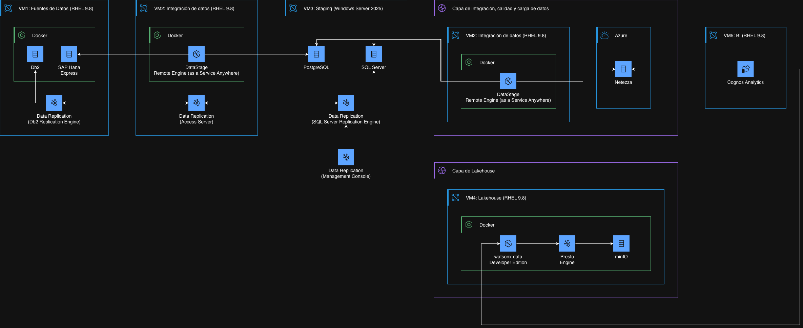
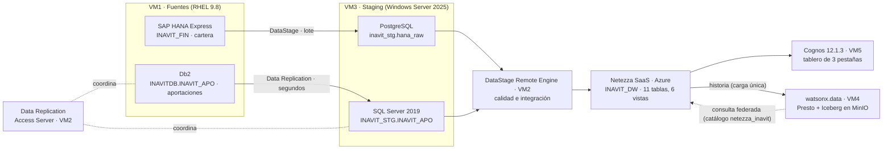

# INAVIT: del dato operativo a la decisión, de punta a punta

## Descripción general

INAVIT es un fondo de vivienda ficticio con datos sintéticos de México. Sus aportaciones
patronales viven en Db2 y su cartera de créditos en SAP HANA, en sistemas aislados, con errores de captura, y sin
forma de ver a tiempo cuando un patrón deja de aportar. La demo sigue al dato de punta a punta: IBM Data
Replication captura los cambios de Db2 en segundos y DataStage extrae la cartera de SAP HANA. DataStage integra y
depura las dos fuentes en Netezza. Cognos Analytics responde las preguntas de negocio y watsonx.data guarda la
historia en un lakehouse abierto, que se consulta junto con los datos recientes de Netezza.

## Fases

**Fase 1 · Fuentes de datos (VM1).** SAP HANA Express guarda la cartera: 105 mil créditos, 2.2 millones de pagos y
la cobranza. Db2 guarda las aportaciones: 15 mil patrones, 251 mil trabajadores y 2.6 millones de aportaciones
bimestrales. Las dos bases corren en Docker, comparten el NSS y la CURP, y traen errores de captura sembrados a
propósito.

**Fase 2 · Replicación en tiempo real (VM1 → VM2 → VM3).** El motor de Data Replication para Db2 lee el log de
transacciones y envía cada cambio, coordinado por el Access Server en VM2, al motor de SQL Server en VM3. Las
aportaciones llegan a staging en segundos, sin triggers ni consultas sobre el sistema fuente. La operación se
administra desde Management Console.

**Fase 3 · Extracción de la cartera (VM1 → VM2 → VM3).** El motor remoto de DataStage (as a Service Anywhere) lee
SAP HANA en lote y copia la cartera sin transformar a PostgreSQL. La cartera cambia en cortes, así que no necesita
captura por log.

**Fase 4 · Integración, calidad y carga (VM3 → VM2 → Netezza).** DataStage lee las dos zonas de staging, SQL Server
con las aportaciones y PostgreSQL con la cartera. Normaliza el NSS, la CURP y el estatus, cruza créditos con
trabajadores y carga el modelo en Netezza. Cada corrección queda marcada con una bandera de calidad. Lo que no se
puede reparar va a una tabla de rechazos con su motivo, y el cuadre con la fuente es exacto: 104,871 integrados
más 444 rechazados igual a 105,315.

**Fase 5 · Almacén analítico (Netezza en Azure).** El esquema `INAVIT_DW` tiene 11 tablas y 6 vistas con las reglas
de negocio:

- la morosidad,
- los patrones omisos y los omisos ocultos (dejaron de aportar pero siguen activos en el padrón),
- los trabajadores precalificados para crédito.

Las consultas sobre millones de filas responden en segundos.

**Fase 6 · Inteligencia de negocio (VM5).** Cognos Analytics responde tres preguntas en un tablero de tres pestañas:

- **Cómo está la cartera:** 8.2% de morosidad, que llega a 38.7% cuando el patrón dejó de aportar.
- **Qué patrones ponen en riesgo la cartera:** 1,083 omisos y 1,800 millones de pesos en riesgo.
- **A quién se le puede prestar:** 25,583 trabajadores precalificados.

**Fase 7 · Lakehouse y consulta federada (VM4).** La historia de aportaciones y pagos se guarda en tablas Iceberg
sobre MinIO, un formato abierto en almacenamiento de objetos de bajo costo. El motor Presto de watsonx.data la
consulta junto con los datos recientes de Netezza a través de una vista federada. El usuario ve una sola tabla, y
el total cuadra exacto con el almacén.

## Dónde vive cada componente

| Host | Sistema operativo | Componentes |
|---|---|---|
| VM1 · Fuentes de datos | RHEL 9.8 | Db2 y SAP HANA Express (Docker); Data Replication: motor de Db2 |
| VM2 · Integración de datos | RHEL 9.8 | DataStage Remote Engine as a Service Anywhere (Docker); Data Replication: Access Server |
| VM3 · Staging | Windows Server 2025 | PostgreSQL; SQL Server 2019; Data Replication: motor de SQL Server y Management Console |
| Netezza SaaS | Azure (East US 2) | Netezza Performance Server, esquema `INAVIT_DW` |
| VM4 · Lakehouse | RHEL 9.8 | watsonx.data Developer Edition, motor Presto y MinIO (Docker / KIND) |
| VM5 · BI | RHEL 9.8 | Cognos Analytics 12.1.3 |

## Flujo del dato (versión en texto)

| Etapa | De → a | Herramienta | Latencia | Por qué así |
|---|---|---|---|---|
| Captura de aportaciones | Db2 `INAVIT_APO` → SQL Server `INAVIT_STG` | Data Replication, lectura del log | Segundos | Son eventos continuos; el log no carga al sistema fuente |
| Extracción de cartera | HANA `INAVIT_FIN` → PostgreSQL `hana_raw` | DataStage | Lote | La cartera cambia en cortes; Data Replication no soporta HANA como origen |
| Calidad e integración | staging → Netezza `INAVIT_DW` | DataStage | Lote | Cruce por NSS/CURP, banderas `DQ_*`, rechazos con motivo |
| Modelo y reglas | dentro de Netezza | Vistas SQL | Inmediato | Las reglas de negocio viven en vistas versionables |
| Consumo | Netezza → Cognos | Cognos (módulo `INAVIT_DM`) | Al consultar | Tablero sobre las vistas |
| Historia | Netezza → MinIO/Iceberg | CSV + Presto CTAS | Carga única | Historia en formato abierto y almacenamiento barato |
| Federación | Presto → Iceberg + Netezza | watsonx.data | 15-20 s | Una tabla lógica sobre dos almacenes |

## Decisiones de diseño

- **Staging fuera de Netezza.** Los datos crudos con NSS, CURP y salarios sin depurar se quedan en VM3;
  Netezza y Cognos solo ven datos validados. Es el argumento de gobierno.
- **SAP HANA solo con DataStage.** Data Replication no tiene HANA como origen.
- **DataStage en modo ETL.** El modo ELT (pushdown) de DataStage no soporta Netezza como destino.
- **Banderas de calidad en lugar de corrección silenciosa.** Cada regla deja un `DQ_*` en 0/1, y lo irreparable
  va a `DQ_CREDITO_HUERFANO` con su motivo. El cuadre con la fuente es exacto.
- **Distribución en Netezza por la llave de cruce** (`NSS`, `NUM_CREDITO`, `REGISTRO_PATRONAL`), para que los
  joins de las vistas se resuelvan sin redistribuir datos.
- **Netezza se registra en watsonx.data como *Data source*, no como *Engine*.** Un engine ejecuta consultas
  (en Developer Edition solo hay Spark); un data source crea un catálogo que Presto consulta y cruza con Iceberg.
- **Corte de historia:** `FACT_APORTACION` con `periodo <= '202506'` (bimestral, `AAAA0B`) y `FACT_PAGO` con
  `periodo <= '202512'` (mensual, `AAAAMM`). Netezza conserva todo; nada se borró del almacén.

## Modelo de datos

- Fuentes: [`vm1-fuentes/docs/modelo-datos.md`](../vm1-fuentes/docs/modelo-datos.md) (tablas, llaves compartidas y la "suciedad" sembrada).
- Netezza: [`05-netezza.md`](05-netezza.md).
