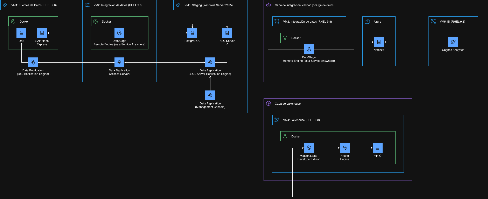

# INAVIT · Guion de la demo end-to-end

> Versión en markdown del guion. La versión editable vive como documento en Claude; si cambias una, actualiza la otra.

## Resumen

La demo dura unos 32 minutos y sigue al dato de punta a punta: una aportación que entra en Db2 llega en segundos a staging con IIDR, DataStage la integra con la cartera de SAP HANA y la carga a Netezza, Cognos la muestra y watsonx.data guarda la historia en un lakehouse que se consulta junto con Netezza.

**La historia.** INAVIT es un fondo de vivienda ficticio con datos sintéticos de México. Sus aportaciones patronales viven en Db2 y su cartera de créditos en SAP HANA. Los dos sistemas no se hablan, los datos traen errores de captura y la mora ligada a patrones que dejan de aportar se detecta tarde. La demo muestra cómo la plataforma de datos de IBM resuelve eso sin tocar los sistemas fuente.



Descripción de cada fase: [`arquitectura.md`](arquitectura.md).

| Componente | Dónde vive | Rol en la demo |
| --- | --- | --- |
| SAP HANA Express (Docker) | VM1 (RHEL 9.8) | Cartera: créditos, pagos y cobranza (esquema `INAVIT_FIN`) |
| Db2 Community (Docker) | VM1 (RHEL 9.8) | Aportaciones patronales: patrones, trabajadores, subcuentas (`INAVITDB.INAVIT_APO`) |
| IBM Data Replication (IIDR) | Motores en VM1 y VM3, Access Server en VM2, Management Console en VM3 | Replica Db2 a SQL Server en segundos (CDC por log) |
| SQL Server 2019 y PostgreSQL | VM3 (Windows Server 2025) | Staging: `INAVIT_STG` (réplica de Db2) y `inavit_stg.hana_raw` (copia de HANA) |
| IBM DataStage Remote Engine (as a Service Anywhere, Docker) | VM2 (RHEL 9.8) | Extrae HANA, aplica calidad, integra las fuentes y carga Netezza |
| Netezza SaaS | Azure (East US 2) | Almacén analítico `INAVIT_DW`: 11 tablas y 6 vistas, unos 5.5 millones de filas |
| Cognos Analytics 12.1.3 | VM5 (RHEL 9.8) | Tablero "INAVIT - Cartera y morosidad" con 3 pestañas |
| watsonx.data Developer Edition | VM4 (RHEL 9.8) | Historia en Iceberg sobre MinIO y vistas federadas con Netezza |

| Acto | Minutos | Mensaje que debe quedar |
| --- | --- | --- |
| 1. El problema y la arquitectura | 3 | Dos sistemas aislados, datos sucios, mora detectada tarde |
| 2. Las fuentes | 4 | Los datos llegan como se capturaron, con errores |
| 3. Replicación en tiempo real | 4 | Un cambio en Db2 aparece en staging en segundos, sin tocar la aplicación |
| 4. DataStage | 6 | Calidad e integración visibles y medibles |
| 5. Netezza | 4 | Un modelo listo para negocio y consultas en segundos |
| 6. Cognos | 5 | Tres preguntas de negocio respondidas en un tablero |
| 7. watsonx.data | 5 | Historia barata en formato abierto, consultada junto con lo caliente |
| Cierre | 1 | Una sola versión confiable del dato, del origen al tablero |

## Antes de grabar

Prepara todo unos 30 minutos antes: la demo depende de cinco VMs y de Netezza SaaS, y el acto 3 falla si la replicación está detenida.

**1. Servicios arriba**

- [ ] VM1: `docker ps` muestra `hxe` y `db2server` en estado Up.
- [ ] IIDR: la suscripción de Db2 a SQL Server está en *Mirroring* en Management Console.
- [ ] VM3: SQL Server y PostgreSQL responden en DBeaver; si DataStage entra por ngrok, el servicio `ngrok` está en Running.
- [ ] DataStage: el flujo de carga a Netezza abre y sus conexiones pasan *Test connection*.
- [ ] Netezza: la instancia (SaaS en Azure) está activa en la consola de IBM Cloud y `SELECT 1;` responde en DBeaver.
- [ ] VM4: si la VM se reinició, corre `sudo bash /opt/repos/wxd-remote-access/start_forwards.sh` y abre la consola.
- [ ] VM5: Cognos responde en `http://localhost:9300/bi/`.

**2. Túneles desde la Mac.** Abre los túneles SSH de cada VM (plantilla en `config/ssh_config.example`): VM1 39041 y 50000, VM3 1433 y 5432, VM4 6443, 9001, 9000 y 8443, VM5 9300.

**3. Línea base.** Confirma que no quedan filas de una demo anterior. Si algo no cuadra, corre los pasos 1 a 3 de `demo-live/INAVIT_demo_live_reset.sql`.

| Dónde | Consulta | Esperado |
| --- | --- | --- |
| Db2 | `SELECT COUNT(*) FROM INAVIT_APO.APORTACION WHERE ORIGEN = 'D';` | 0 |
| SQL Server | `SELECT COUNT(*) FROM INAVIT_APO.APORTACION WHERE ORIGEN = 'D';` | 0 |
| Netezza | `SELECT COUNT(*) FROM INAVIT_DW.FACT_APORTACION;` | 2,639,227 |
| Netezza | `SELECT COUNT(*) FROM INAVIT_DW.V_PATRON_OMISO;` | 1,083 |
| Cognos | KPIs de las 3 pestañas | 104,871 créditos, 1,083 omisos, 25,583 precalificados |

**4. Calentar.** Corre una vez la consulta de la vista federada en watsonx.data (la primera tarda más) y abre el tablero de Cognos una vez.

**5. Ventanas en orden de aparición.** Diagrama de arquitectura; DBeaver con un script por conexión (HXE, INAVITDB, INAVIT_STG, inavit_stg, Netezza); IIDR Management Console; DataStage con el flujo abierto; Cognos con el tablero; watsonx.data en Query workspace con la hoja `INAVIT_Vistas_Federadas`; consola de MinIO en `iceberg-bucket`.

**6. Para la grabación.** Silencia notificaciones, sube la fuente de DBeaver a 14 o más, graba a 1080p y cierra cualquier ventana con contraseñas o con la IP de las VMs.

## Acto 1. El problema y la arquitectura (3 min)

El objetivo es que la audiencia entienda en tres minutos qué duele en INAVIT y por dónde va a viajar el dato.

**Qué mostrar.** El diagrama de arquitectura (`docs/img/arquitectura.png`). Señala las fases en orden: fuentes en VM1, replicación y extracción hacia el staging en VM3, integración en VM2, Netezza en Azure, Cognos en VM5 y el lakehouse en VM4.

**Qué ejecutar.** Nada.

**Qué decir.**

> "INAVIT es un fondo de vivienda: recibe aportaciones de los patrones y otorga créditos hipotecarios a los trabajadores. Las aportaciones viven en Db2 y la cartera de créditos en SAP HANA. Son dos sistemas que no se hablan."

> "Eso tiene tres consecuencias. Primero, cada área tiene su propia cifra. Segundo, los datos traen errores de captura: un mismo trabajador aparece con la CURP en minúsculas o con espacios en el NSS. Tercero, cuando un patrón deja de aportar, el riesgo en la cartera se ve semanas después."

> "Vamos a seguir un dato de punta a punta. IBM Data Replication captura los cambios de Db2 en segundos. DataStage extrae SAP HANA, limpia e integra las dos fuentes. Netezza es el almacén analítico, Cognos el tablero, y watsonx.data guarda la historia en un lakehouse abierto."

> "Todo es sintético: INAVIT no existe y ningún NSS, CURP o RFC es real."

**Transición.** "Empecemos por los sistemas fuente, tal como están hoy."

## Acto 2. Las fuentes en VM1 (4 min)

El objetivo es mostrar que los datos llegan como se capturaron, con errores que alguien tiene que resolver antes de reportar.

**Qué mostrar.** DBeaver con las conexiones `HXE` (SAP HANA, puerto 39041) e `INAVITDB` (Db2, puerto 50000), dentro de la carpeta Orígenes.

**Qué ejecutar en SAP HANA (`INAVIT_FIN`).**

```sql
-- Volumen de la cartera: 105,315 créditos
SELECT COUNT(*) FROM INAVIT_FIN.CREDITO;

-- El mismo estatus capturado de varias formas (Vigente, vigente, VIG...)
SELECT ESTATUS_CREDITO, COUNT(*) AS N
FROM INAVIT_FIN.CREDITO
GROUP BY ESTATUS_CREDITO ORDER BY N DESC;

-- Identificadores sucios: CURP nula o en minúsculas, NSS con espacio al inicio
SELECT NUM_CREDITO, '[' || NSS || ']' AS NSS, CURP, NOMBRE_ACREDITADO
FROM INAVIT_FIN.CREDITO
WHERE CURP IS NULL OR CURP <> UPPER(CURP) OR NSS LIKE ' %'
LIMIT 10;
```

**Qué ejecutar en Db2 (`INAVIT_APO`).**

```sql
-- 15,000 patrones, 251,272 trabajadores y 2,639,227 aportaciones
SELECT (SELECT COUNT(*) FROM INAVIT_APO.PATRON)     AS PATRONES,
       (SELECT COUNT(*) FROM INAVIT_APO.TRABAJADOR) AS TRABAJADORES,
       (SELECT COUNT(*) FROM INAVIT_APO.APORTACION) AS APORTACIONES
FROM SYSIBM.SYSDUMMY1;

-- Una misma CURP con dos NSS distintos (duplicados de captura)
SELECT CURP, COUNT(*) AS NSS_DISTINTOS
FROM INAVIT_APO.TRABAJADOR
WHERE CURP IS NOT NULL
GROUP BY CURP HAVING COUNT(*) > 1
FETCH FIRST 5 ROWS ONLY;
```

**Qué decir.**

> "Esto es SAP HANA con la cartera: 105 mil créditos. Fíjense en el estatus: 'Vigente', 'vigente' con espacio, 'VIG'. Para un reporte son cosas distintas, para el negocio son lo mismo."

> "Y aquí hay CURP nulas, en minúsculas, NSS con un espacio al inicio. Con eso un cruce simple contra aportaciones falla en silencio."

> "Del otro lado, Db2: 15 mil patrones, 251 mil trabajadores y 2.6 millones de aportaciones bimestrales. También hay trabajadores duplicados con la misma CURP. Estos dos sistemas comparten el NSS y la CURP, pero hoy nadie los cruza."

**Transición.** "Lo primero es sacar los datos de los sistemas fuente sin afectarlos. Empezamos por Db2, en tiempo real."

## Acto 3. Replicación en tiempo real con IIDR (4 min)

Este es el primer momento en vivo: 10 aportaciones nuevas en Db2 aparecen en SQL Server en segundos, sin tocar la aplicación ni lanzar un proceso.

**Qué mostrar.** Primero IIDR Management Console con la suscripción de Db2 a SQL Server en estado *Mirroring* y su vista de monitoreo (latencia y operaciones). Después DBeaver, con Db2 y SQL Server lado a lado.

**Qué ejecutar.**

1. En SQL Server (`INAVIT_STG`), la línea base:

```sql
SELECT COUNT(*) AS DEMO_EN_VIVO FROM INAVIT_APO.APORTACION WHERE ORIGEN = 'D';   -- 0
```

2. En Db2 (`INAVITDB`), el paso 4 de `INAVIT_demo_live_reset.sql`: los 10 `INSERT` de aportaciones del periodo 202606, con `APORTACION_ID` 100000000 a 100000009 y `ORIGEN = 'D'`. DBeaver está en Auto-commit, así que se confirman al ejecutar.
3. Cuenta en voz alta hasta cinco y vuelve a SQL Server:

```sql
SELECT APORTACION_ID, NSS, REGISTRO_PATRONAL, PERIODO, MONTO_APORTACION, FECHA_REGISTRO
FROM INAVIT_APO.APORTACION
WHERE ORIGEN = 'D'
ORDER BY APORTACION_ID;   -- 10 filas
```

4. Regresa a Management Console y muestra que el contador de operaciones subió en 10.

**Qué decir.**

> "IBM Data Replication lee el log de transacciones de Db2. No hay triggers, no hay consultas periódicas, no se modifica la aplicación. La carga sobre el sistema fuente es mínima."

> "Voy a registrar 10 aportaciones de patrones, como si llegaran del sistema de recaudación... Listo. Y aquí están en SQL Server, la zona de staging, en segundos."

> "Esto importa para el negocio: si un patrón que llevaba meses sin pagar vuelve a aportar, o deja de hacerlo, la analítica lo sabe hoy, no al cierre del mes."

**Si quieres un efecto más visual.** En VM1 puedes correr `bash scripts/demo-live-insert.sh -n 10 -d 2`, que inserta una aportación cada 2 segundos y las ves llegar una por una. Ojo: ese script también suma la aportación a `SUBCUENTA_VIVIENDA`, y el reset no revierte ese cambio. Para grabaciones repetibles usa los `INSERT` fijos.

**Transición.** "Ya tenemos las aportaciones al día. Ahora hay que juntarlas con la cartera de SAP HANA, y limpiarlas."

## Acto 4. DataStage: calidad e integración hacia Netezza (6 min)

El objetivo es que la calidad se vea y se pueda medir: cada corrección deja una bandera, y los 105,315 créditos de HANA cuadran exactos con 104,871 integrados más 444 rechazados con motivo.

**Qué mostrar.**

1. El flujo que copia SAP HANA a PostgreSQL (`inavit_stg.hana_raw`). Explica que HANA se lee en lote, porque la cartera cambia en cortes y no necesita captura por log.
2. El flujo de integración y carga a Netezza: lee `INAVIT_STG` (SQL Server) y `hana_raw` (PostgreSQL), normaliza, cruza por NSS y CURP, separa los rechazos y escribe en `INAVIT_DW`. Recorre las etapas de izquierda a derecha y abre el Transformer para enseñar dos o tres reglas: `TRIM` y `UPPER` del NSS y la CURP, la normalización del estatus y el `MUNICIPIO` en mayúsculas.

**Qué ejecutar.**

1. Corre el flujo de carga a Netezza. Tarda unos minutos: en la grabación corta mientras corre, o llena el tiempo con las consultas del paso 2.
2. Mientras tanto, en Netezza, las banderas de calidad sobre la cartera ya integrada (también en `netezza/91_consultas_demo.sql`):

```sql
-- El estatus queda en un solo catálogo (VIGENTE, MOROSO, CARTERA_VENCIDA...)
SELECT ESTATUS_CREDITO, COUNT(*) AS N
FROM INAVIT_DW.CREDITO_INTEGRADO GROUP BY ESTATUS_CREDITO ORDER BY N DESC;

-- Cuántos registros corrigió cada regla
SELECT SUM(DQ_NSS_CORREGIDO)     AS NSS,
       SUM(DQ_CURP_CORREGIDA)    AS CURP,
       SUM(DQ_ESTATUS_CORREGIDO) AS ESTATUS,
       SUM(DQ_NOMBRE_CORREGIDO)  AS NOMBRE,
       SUM(DQ_FECHA_NAC_INVALIDA) AS FECHA_NAC
FROM INAVIT_DW.CREDITO_INTEGRADO;

-- Cuadre: 104,871 integrados + 444 rechazados = 105,315 de HANA
SELECT (SELECT COUNT(*) FROM INAVIT_DW.CREDITO_INTEGRADO)   AS INTEGRADOS,
       (SELECT COUNT(*) FROM INAVIT_DW.DQ_CREDITO_HUERFANO) AS RECHAZADOS;

SELECT MOTIVO, COUNT(*) AS N FROM INAVIT_DW.DQ_CREDITO_HUERFANO GROUP BY MOTIVO;
```

3. Al terminar el flujo, las aportaciones del acto 3 ya están en el almacén:

```sql
SELECT COUNT(*) FROM INAVIT_DW.FACT_APORTACION;   -- 2,639,237 (antes 2,639,227)
SELECT APORTACION_ID, NSS, PERIODO, MONTO_APORTACION, FECHA_CARGA
FROM INAVIT_DW.FACT_APORTACION WHERE ORIGEN = 'D' ORDER BY APORTACION_ID;
```

**Qué decir.**

> "DataStage hace el trabajo que hoy se hace a mano en hojas de cálculo. Limpia el NSS y la CURP, unifica el estatus y cruza la cartera de SAP con las aportaciones de Db2 por el trabajador."

> "Y cada corrección queda marcada. No escondemos el problema: sabemos cuántas CURP corregimos y cuántos estatus unificamos. Esa es la evidencia para el área de calidad."

> "Lo que no se puede reparar no se pierde. Estos 444 créditos tienen un NSS que no existe en el padrón. Van a una tabla de rechazos con su motivo, y el cuadre es exacto: 104,871 más 444 da los 105,315 de SAP."

> "Y las 10 aportaciones que registramos hace un momento ya están en el almacén analítico."

**Antes de grabar, llena esto.** Pon aquí el nombre real de tus dos flujos de DataStage y cuánto tarda la carga a Netezza en tu ensayo, para saber cuánto tiempo cubrir o cortar.

**Transición.** "Con el dato limpio en Netezza, veamos el modelo que lo convierte en respuestas."

## Acto 5. Netezza: modelo y reglas de negocio (4 min)

El objetivo es mostrar que las preguntas de negocio ya están resueltas en el modelo, y que sobre millones de filas responden en segundos.

**Qué mostrar.** En DBeaver, el esquema `INAVIT_DW` expandido: 11 tablas (dimensiones, hechos, `CREDITO_INTEGRADO` y la tabla de rechazos) y 6 vistas. Menciona que las tablas grandes se distribuyen por la llave de cruce (NSS o NUM_CREDITO), así los joins se resuelven en paralelo sin mover datos entre nodos.

**Qué ejecutar.**

```sql
-- 1. La pregunta clave: ¿la mora sube cuando el patrón deja de aportar?
SELECT COALESCE(PATRON_OMISO, 0) AS PATRON_OMISO,
       COUNT(*) AS CREDITOS,
       SUM(ES_MOROSO) AS MOROSOS,
       ROUND(100.0 * SUM(ES_MOROSO) / COUNT(*), 1) AS PCT_MORA
FROM INAVIT_DW.V_FACT_CREDITO
GROUP BY COALESCE(PATRON_OMISO, 0);

-- 2. Patrones omisos y omisos ocultos (siguen activos en el padrón): 1,083 y 455
SELECT COUNT(*) AS OMISOS, SUM(OMISO_OCULTO) AS OCULTOS,
       SUM(SALDO_EN_RIESGO) AS SALDO_EN_RIESGO
FROM INAVIT_DW.V_PATRON_OMISO;

-- 3. Recaudación por bimestre sobre 2.6 millones de aportaciones
SELECT PERIODO, COUNT(*) AS APORTACIONES, SUM(MONTO_APORTACION) AS MONTO
FROM INAVIT_DW.V_FACT_APORTACION
GROUP BY PERIODO ORDER BY PERIODO;

-- 4. Trabajadores precalificados para crédito: 25,583
SELECT COUNT(*) FROM INAVIT_DW.V_PRECALIFICADOS;
```

En la consulta 1 el porcentaje de mora con patrón omiso debe salir muy por encima del resto; anota las cifras en el ensayo y compáralas con la gráfica de Cognos del acto 6 (38.7% contra 6.7%).

**Qué decir.**

> "Un patrón omiso es el que dejó de aportar. Lo interesante son los omisos ocultos: 455 patrones que siguen activos en el padrón, pero ya no pagan. Nadie los está viendo."

> "Y aquí está la relación con la cartera: cuando el patrón deja de aportar, la mora de sus trabajadores se dispara. Ese es el aviso temprano que INAVIT no tenía."

> "La regla de precalificación también vive aquí: trabajador activo, sin crédito, sin duplicado de CURP, con 24 bimestres o más y al menos 150 mil pesos en su subcuenta. Son 25,583 personas a las que se les puede ofrecer un crédito hoy. Si negocio cambia un umbral, se cambia la vista y el tablero se actualiza."

> "Y todo esto corre sobre millones de filas en segundos, en un servicio administrado: nadie aquí afina índices."

**Transición.** "Pero el usuario de negocio no va a abrir un editor de SQL. Para eso está Cognos."

## Acto 6. Cognos: el tablero de 3 pestañas (5 min)

El objetivo es que el negocio vea tres preguntas respondidas con las mismas cifras que acabamos de calcular en Netezza.

**Qué mostrar.** El tablero "INAVIT - Cartera y morosidad" en `http://localhost:9300/bi/`, en modo de consulta (Edit apagado). Recorre las pestañas en orden y detén el cursor sobre cada KPI mientras lo nombras.

| Pestaña | KPIs que debes ver | Gráfica a señalar |
| --- | --- | --- |
| Cartera y morosidad | 104,871 créditos · MX$37,417,573,857 de saldo · MX$1,801,355,673 en patrones omisos · 8.2% de morosidad | Morosidad: patrón omiso 38.7% contra 6.7% al corriente |
| Patrones omisos | 1,083 omisos · 455 ocultos · 11,595 trabajadores afectados · MX$1,801,355,673 en riesgo | Saldo en riesgo por entidad (Ciudad de México, MX$185,627,046) y el Top 10 de patrones |
| Precalificados | 25,583 precalificados · MX$225,527 de saldo promedio · MX$5,769,664,485 acumulado · 123 bimestres promedio | Precalificados por entidad (Ciudad de México, 4,717) y por rango de saldo |

**Qué ejecutar.** Nada en SQL. En la pestaña 1 haz clic en la barra "Patrón omiso" para filtrar las demás visualizaciones, y vuelve a hacer clic para quitar el filtro. Pruébalo en el ensayo: depende de que las visualizaciones estén conectadas.

**Qué decir.**

> "Primera pregunta: ¿cómo está la cartera? 104,871 créditos, 37 mil millones de pesos de saldo y 8.2% de morosidad. Y la gráfica que importa: con patrón omiso, la mora es de 38.7%. Al corriente, 6.7%. Casi seis veces más."

> "Segunda pregunta: ¿quiénes son esos patrones? 1,083 dejaron de aportar, y 455 siguen como activos en el padrón. Detrás hay 11,595 trabajadores y 1,800 millones de pesos en riesgo. Aquí están por estado, por sector, y los diez patrones con más saldo expuesto. Esta lista es accionable para cobranza hoy mismo."

> "Tercera pregunta, la de crecimiento: ¿a quién le puedo prestar? 25,583 trabajadores cumplen la regla, con 225 mil pesos promedio en su subcuenta. Es una cartera de colocación de 5,700 millones lista para una campaña."

> "Y son las mismas cifras que vimos en Netezza. Una sola versión del dato, del sistema fuente al tablero."

**Si te preguntan por los 123 bimestres promedio.** Equivalen a unos 20 años de cotización; la regla exige al menos 24 bimestres, y los precalificados son, por construcción, los trabajadores con más antigüedad y saldo. Ten esa respuesta lista.

**Transición.** "Netezza tiene todo, incluida la historia. Pero guardar años de movimientos en el almacén de alto rendimiento no siempre es lo más eficiente. Aquí entra watsonx.data."

## Acto 7. watsonx.data: historia en Iceberg y vista federada (5 min)

El objetivo es mostrar que la historia puede vivir en almacenamiento barato y abierto, y que el usuario la consulta junto con los datos calientes de Netezza como si fuera una sola tabla.

**Qué mostrar.**

1. *Infrastructure manager*: el motor `presto-01` conectado a los catálogos `iceberg_data`, `hive_data` y `netezza_inavit`, y debajo los buckets de MinIO.
2. Consola de MinIO (`http://localhost:9001`): `iceberg-bucket/inavit_dw/fact_aportacion/`, con la carpeta `metadata` y los datos en carpetas por `periodo`.
3. *Query workspace* con la hoja `INAVIT_Vistas_Federadas`.

**Qué ejecutar.**

```sql
-- 1. Solo la historia, en Iceberg: 8 bimestres (202405 a 202506), menos de un segundo
SELECT periodo, COUNT(*) AS filas, SUM(monto_aportacion) AS monto
FROM iceberg_data.inavit_dw.fact_aportacion
GROUP BY periodo ORDER BY periodo;

-- 2. La vista federada: historia en Iceberg + 2026 en Netezza
SELECT fuente, COUNT(*) AS filas, SUM(monto_aportacion) AS suma
FROM iceberg_data.inavit_dw.v_fact_aportacion
GROUP BY fuente;
```

Sin las filas en vivo, la consulta 2 da lakehouse 1,713,809 y netezza 925,418, que suman 2,639,227. Si ya corriste el acto 4, las 10 aportaciones del periodo 202606 vienen de Netezza: la fila netezza da 925,428 y el total 2,639,237. Tarda de 15 a 20 segundos.

Opcional, si te preguntan cómo se reparte el trabajo: corre `EXPLAIN` sobre la consulta 2 y señala la rama que lee Iceberg y la que lee Netezza.

**Qué decir.**

> "Netezza es ideal para lo que se consulta todos los días. Pero años de historia que casi nadie toca no tienen por qué vivir en el almacén más rápido."

> "Aquí está esa historia en watsonx.data: 1.7 millones de aportaciones y 1.2 millones de pagos en tablas Iceberg, sobre almacenamiento de objetos. Iceberg es un formato abierto: lo puede leer Presto, Spark u otro motor, sin quedar atado a uno."

> "Y el usuario no tiene que saber dónde está cada cosa. Esta vista une la historia del lakehouse con lo reciente de Netezza. Miren la columna fuente: una parte viene del lakehouse y otra de Netezza, y el total cuadra exacto con el almacén."

> "Y las 10 aportaciones que registramos al principio en Db2 también están aquí, del lado de Netezza. Es el mismo dato, de punta a punta."

**Si te preguntan por qué tarda más.** Presto lee Netezza por la red, desde la VM hasta el servicio en la nube. En producción los dos estarían en la misma región, y la consulta que solo toca la historia responde en menos de un segundo.

**Transición.** "Recapitulemos lo que vimos."

## Cierre, reset y plan B

**Cierre (1 min). Qué decir.**

> "Empezamos con dos sistemas aislados y datos sucios. En segundos, IBM Data Replication llevó las aportaciones a staging sin tocar Db2. DataStage limpió e integró la cartera de SAP, y dejó evidencia de cada corrección. Netezza convirtió eso en respuestas sobre millones de filas. Cognos se las mostró al negocio. Y watsonx.data guarda la historia en formato abierto, consultable junto con lo de hoy."

> "El resultado para INAVIT: una sola versión del dato, el riesgo de los patrones omisos visible a tiempo, y 25 mil trabajadores listos para un crédito."

**Reset después de grabar.** DataStage no propaga borrados a Netezza, así que se limpia en las dos puntas con `demo-live/INAVIT_demo_live_reset.sql` (detalle en [`08-demo-en-vivo.md`](08-demo-en-vivo.md)):

1. Db2: el `DELETE` del paso 1 (10 filas con `ORIGEN = 'D'`).
2. SQL Server: espera un minuto y confirma que IIDR replicó el borrado (`COUNT(*)` = 0). Si no, IIDR está detenido: inícialo y espera, o corre el `DELETE` comentado del paso 2.
3. Netezza: el `DELETE` del paso 3. `FACT_APORTACION` vuelve a 2,639,227.
4. Comprueba la tabla de línea base de la sección *Antes de grabar*.

**Plan B si algo falla en vivo.**

| Falla | Síntoma | Qué hacer |
| --- | --- | --- |
| IIDR detenido | Las 10 filas no llegan a SQL Server | Inicia la suscripción en Management Console; los cambios pendientes se aplican al arrancar. Mientras, sigue con el acto 4 sobre los datos ya cargados |
| Flujo de DataStage lento o con error | No aparecen las filas en Netezza | Muestra las consultas de calidad del acto 4 y retoma las filas en vivo en el acto 7 |
| Netezza no responde | Consultas colgadas; DBeaver no cancela | Revisa la instancia en IBM Cloud. Si DBeaver se congela, ciérralo a la fuerza y reabre. Continúa con Cognos si su caché responde |
| Vista federada lenta | Más de 30 segundos | Muestra primero la consulta solo de Iceberg y explica la latencia de red |
| Túnel caído en VM4 | La consola de watsonx.data no abre | En VM4: `sudo bash /opt/repos/wxd-remote-access/start_forwards.sh` y vuelve a abrir el túnel en la Mac |

**Para una versión corta de 15 minutos.** Haz los actos 1, 3, 6 y 7, y menciona DataStage y Netezza con una diapositiva.
